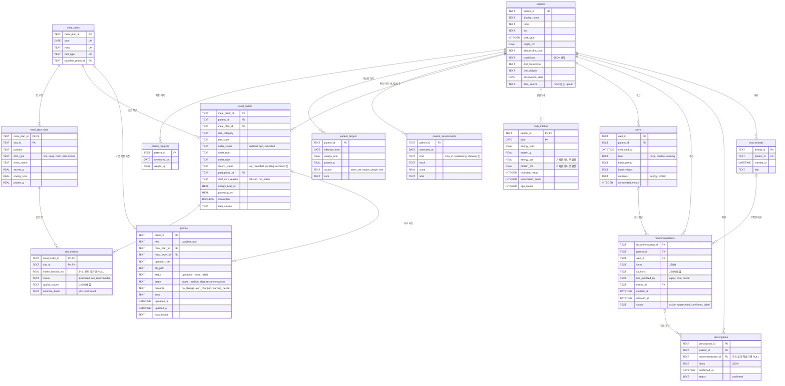

# 하루 파일럿 데이터 모델 (팀 제안안)

**상태**: 팀 제안안 — 팀 회의에서 확정 전 · **작성일**: 2026-11-27
**관련 문서**: [시스템 구조](system-architecture.md) · [하루 파일럿 설계 전 검토](pilot-design-review.md) · [샘플: 가상 환자 NS07](samples/ns07/README.md)

데이터를 **환자**, **예정 식단**, **실제 발주된 식사** 세 묶음으로 나눈다. 세 묶음은 바뀌는 주기와 주인이 다르다.

| 묶음 | 단위 | 바뀌는 때 | 누가 만드나 |
| --- | --- | --- | --- |
| 환자 | 환자 1명 | 체중 측정, 평가, 목표 변경 때 | 등록 · 진료팀 |
| 예정 식단 | 날짜 × 끼니 × 식사 종류 (모든 환자 공통) | 끼니마다 한 번 | 사전 입력 데이터 (배식 계획) · 기준 식전 사진은 영양사 |
| 실제 발주된 식사 | 환자 × 끼니 | 끼니마다 환자별로 | 발주는 사전 입력 데이터 · 식후 사진은 요양보호사 · 섭취는 분석 |

저장소는 SQLite이므로 아래 "컬렉션"은 테이블로 만든다. 접근 제어는 두지 않는다 ([시스템 구조](system-architecture.md) 1절).

**파일럿 범위**

- **배식 계획은 사전 입력 데이터로 테스트한다.** `meal_plans`와 `meal_plan_slots`는 시드 스크립트(`scripts/seed.py`)로 넣고, 배식 계획을 입력·수정하는 화면은 만들지 않는다. 화면 ①은 계획을 보여 주기만 한다.
- **발주와 발주 특이사항도 사전 입력 데이터다.** 요양보호사가 화면에서 특이사항(`order_note`)을 기록하는 기능은 파일럿 범위 밖이다.

## 1. 전체 관계 (ERD)



- 관계 기호: `||--o{`는 1 대 0개 이상, `||--|{`는 1 대 1개 이상, `|o--o|`는 0~1 대 0~1이다.
- `slot_intakes`는 `meal_orders`의 칸별 섭취이고, `slot_id`로 같은 끼니의 `meal_plan_slots` 칸을 가리킨다.
- `alerts`, `recommendations`, `prescriptions`, `chat_threads`의 ID 필드는 6절 표에서 생략했다.

## 2. 환자 컬렉션

### `patients`

| 필드 | 타입 | 설명 |
| --- | --- | --- |
| `patient_id` | TEXT PK | 예: `NS07` |
| `display_name` | TEXT | 화면 표시 이름 (가명. 예: "NS07") |
| `room` | TEXT | 병실. 예: "302호". 화면은 "302호 · NS07"처럼 병실과 이름을 붙여 표시한다. |
| `sex` | TEXT | `female` / `male` |
| `birth_year` | INTEGER | 나이 계산용. 생년월일 전체는 두지 않는다. |
| `height_cm` | REAL | |
| `default_diet_type` | TEXT | 기본 식사 종류. 파일럿은 `general`(일반식)만 |
| `conditions` | TEXT (JSON 배열) | 기저질환. 예: `["고혈압", "퇴행성 무릎관절염"]` |
| `diet_restrictions` | TEXT | 의료진이 기록한 식이 제한. 없으면 빈 문자열 |
| `ckd_dialysis` | TEXT | `none` / `ckd` / `dialysis` |
| `observation_start` | DATE | 관찰 시작일 |
| `data_source` | TEXT | `mock` / `upload` |

### `patient_weights`

체중 감소 판단(GLIM 기준 등)을 위해 측정할 때마다 한 건씩 둔다.

| 필드 | 타입 | 설명 |
| --- | --- | --- |
| `patient_id` | TEXT FK | |
| `measured_on` | DATE | |
| `weight_kg` | REAL | |

### `patient_targets`

| 필드 | 타입 | 설명 |
| --- | --- | --- |
| `patient_id` | TEXT FK | |
| `effective_from` | DATE | 적용 시작일. 가장 최근 것이 현재 목표 |
| `energy_kcal` | REAL | 하루 에너지 목표 |
| `protein_g` | REAL | 하루 단백질 목표 |
| `source` | TEXT | `team_set`(진료팀 설정) / `espen_weight`(체중 기반 계산) / `kdri`(한국인 영양소 섭취기준) |
| `note` | TEXT | 설정 근거 |

**목표량을 정하는 규칙**: 진료팀이 설정한 목표(`team_set`)가 있으면 그것을 쓴다. 없으면 시스템이 계산한다: 체중이 있으면 ESPEN(30 kcal/kg, 단백질 1.0 g/kg), 없으면 2025 한국인 영양소 섭취기준(성별·연령). 하루 %와 경고 판정은 **그날 적용된 목표**를 분모로 쓴다 (결정). 목표가 바뀌어도 과거 날짜의 %와 경고 근거는 다시 계산하지 않는다.

### `patient_assessments`

| 필드 | 타입 | 설명 |
| --- | --- | --- |
| `patient_id` | TEXT FK | |
| `assessed_on` | DATE | |
| `kind` | TEXT | `mna_sf` / `nutrition_screening`(도구를 밝히지 않은 영양위험 선별) / `swallowing` / `chewing` / `appetite_assist` / `pressure_injury` / `refeeding_risk` |
| `result` | TEXT | 요약 결과. 예: `at_risk`, `no_cough_observed` |
| `score` | REAL | 점수가 있는 평가만. 예: MNA-SF 10 |
| `note` | TEXT | 관찰 내용 |

평가는 처방 추천 에이전트의 근거로 쓴다. 예를 들어 씹기 불편 기록이 있으면 식사 형태 조정(다진찬)을 추천 후보로 검토한다.

**의사 화면 표시 (결정)**: 의사 화면(③)의 환자 요약 아래에 읽기 전용 요약 카드를 둔다. 에이전트가 근거로 쓰는 정보를 의사도 같은 화면에서 확인하게 하기 위해서다.

```
환자 NS07 · 여 · 82세 · 154 cm
체중 50.0 kg (11/23) · 한 달 −2.0 kg (−3.8%) · BMI 21.1
목표 1,500 kcal · 단백질 55 g (진료팀 설정 · 11/23~)
평가 (11/23)  MNA-SF 10점 영양불량 위험 · 씹기: 틀니 불편 · 식욕 저하
              삼킴: 사레 없음(정식 평가 전) · 욕창 없음 · 재급식 위험 아님
```

목표 줄에는 출처(진료팀 설정 / ESPEN 체중 기반 / 한국인 영양소 섭취기준)를 항상 함께 표시한다.

## 3. 예정 식단 컬렉션

### `meal_plans`

| 필드 | 타입 | 설명 |
| --- | --- | --- |
| `meal_plan_id` | TEXT PK | 예: `2026-11-23_lunch_general` |
| `date` | DATE | |
| `meal` | TEXT | `breakfast` / `lunch` / `dinner` |
| `diet_type` | TEXT | `general` |
| `baseline_photo_id` | TEXT FK, NULL | 영양사가 올린 기준 식전 사진 |

`(date, meal, diet_type)`은 유일하다.

### `meal_plan_slots`

한 끼의 칸 구성. 국내 일반식은 **밥, 국, 주찬, 부찬 2, 김치의 6칸**이 표준이다 (춘천시 사회복지급식관리지원센터 2025년 8월 일반식 93끼 중 92끼).

| 필드 | 타입 | 설명 |
| --- | --- | --- |
| `meal_plan_id` | TEXT FK | |
| `slot_id` | TEXT | `slot_1` ~ `slot_6` |
| `position` | TEXT | 식판 위치 설명. 예: "아랫줄 왼쪽" |
| `dish_type` | TEXT | `rice` / `soup` / `main` / `side` / `kimchi` |
| `menu_name` | TEXT | 예: "두부조림" |
| `served_g` | REAL | 표준 배식량 (팀이 저울로 잰 값) |
| `energy_kcal` | REAL | 표준 배식량 기준 에너지 |
| `protein_g` | REAL | 표준 배식량 기준 단백질 |

**식판 칸 배치 (6칸 고정)**: 파일럿은 모든 끼니가 같은 식판과 같은 칸 배치를 쓴다. 칸 ID가 곧 식판 위치이므로, 화면·섭취 추정·시드 데이터가 모두 이 표를 따른다.

| `slot_id` | `position` | `dish_type` |
| --- | --- | --- |
| `slot_1` | 아랫줄 왼쪽 | `rice` (밥) |
| `slot_2` | 아랫줄 오른쪽 | `soup` (국) |
| `slot_3` | 윗줄 1 (왼쪽 끝) | `main` (주찬) |
| `slot_4` | 윗줄 2 | `side` (부찬) |
| `slot_5` | 윗줄 3 | `side` (부찬) |
| `slot_6` | 윗줄 4 (오른쪽 끝) | `kimchi` (김치) |

```
┌────────┬────────┬────────┬────────┐
│ slot_3 │ slot_4 │ slot_5 │ slot_6 │   윗줄: 주찬 · 부찬 · 부찬 · 김치
│  주찬  │  부찬  │  부찬  │  김치  │
├────────┴────────┼────────┴────────┤
│     slot_1      │     slot_2      │   아랫줄: 밥 · 국
│       밥        │       국        │
└─────────────────┴─────────────────┘
```

- 영양성분은 식약처 식품영양성분 데이터로 채운다. 표준레시피의 식재료명(예: "근대, 생것")이 그 데이터의 식품명 형식과 같아 재료별로 합산할 수 있다.
- 표준레시피의 식재료량은 조리 전 무게라 국물이 빠져 있다. 배식량은 저울 실측값을 쓴다.
- **간식 제외, 3끼 기준 (결정)**: 간식은 식판 사진 분석 대상이 아니므로 배식 계획에 넣지 않고 하루 섭취량에서도 뺀다. 하루 %는 3끼 섭취를 하루 목표와 비교한다. 실제보다 낮게 잡힐 수 있으므로, 추이 그래프와 추천 카드에 "간식 제외, 3끼 기준"을 표시한다.

## 4. 실제 발주된 식사 컬렉션

### `meal_orders`

환자 한 명의 한 끼. 발주(어떤 식사가 나가야 하는지)와 급식 결과(실제로 얼마나 먹었는지)를 함께 둔다. 필드는 실제 병원의 급식 처방 기록(인천보훈병원 급식정보: 식사범주, 식사코드, 개시끼니·개시일자, 특이사항)을 참고했다.

| 필드 | 타입 | 설명 |
| --- | --- | --- |
| `meal_order_id` | TEXT PK | 예: `NS07_2026-11-23_lunch` |
| `patient_id` | TEXT FK | |
| `meal_plan_id` | TEXT FK | |
| `diet_category` | TEXT | 식사 범주. 예: "상식", "연식" |
| `diet_code` | TEXT | 식사 코드. 예: "일반상식", "일반상식(다진찬)" |
| `order_status` | TEXT | `ordered` / `npo`(금식) / `cancelled`(외출·퇴원 등). 세 가지로 확정 (결정) |
| `order_from` | TEXT | 이 식사 처방이 시작된 날짜·끼니. 예: `2026-11-23 breakfast` |
| `order_note` | TEXT | 특이사항. 예: "딱딱한 반찬 다져서". 파일럿은 사전 입력값만 쓰고 화면에서 기록하지 않는다. |
| `record_status` | TEXT | 아래 표 |
| `post_photo_id` | TEXT FK, NULL | 요양보호사가 올린 식후 사진 |
| `staff_zero_reason` | TEXT, NULL | 직원이 끼니 단위로 0을 확인한 이유: `refused`(전량 거부) / `not_eaten`(식판을 받았지만 전량 미섭취). 이때 모든 칸은 0%, `estimate_basis = "staff"`, `record_status = "recorded"` |
| `energy_kcal_est` | REAL, NULL | 이 끼니의 에너지 섭취량 (계산값) |
| `protein_g_est` | REAL, NULL | 이 끼니의 단백질 섭취량 (계산값) |
| `incomplete` | BOOLEAN | 판단 불가 칸이 있어 합계가 불완전한지 |
| `data_source` | TEXT | `mock` / `upload` |

**기록 상태 (`record_status`)**

| 값 | 뜻 |
| --- | --- |
| `not_recorded` | 발주됐지만 식후 사진이 없음 (미기록) |
| `pending` | 식후 사진이 올라와 분석을 기다리거나 분석 중 |
| `recorded` | 칸별 섭취가 기록됨 (일부 칸이 판단 불가여도 기록됨) |
| `not_determinable` | 사진 전체를 판단할 수 없음 |
| `failed` | 분석 실패. 재시도 필요 |

**경고 계산에서 끼니를 다루는 규칙**

| 발주 상태 | 기록 상태 | 처리 |
| --- | --- | --- |
| `ordered` | `recorded` | 섭취량에 포함 |
| `ordered` | `not_recorded` · `not_determinable` · `failed` | 평균에서 빼고 미기록 수로 센다 |
| `ordered` | `pending` | 아직 집계하지 않는다 |
| `npo` · `cancelled` | (해당 없음) | 식사가 나가지 않았으므로 평균에서 빼고 미기록으로도 세지 않는다 |

**전량 거부·전량 미섭취 (결정)**: 요양보호사 화면(②)에 "전량 거부"·"전량 미섭취" 버튼을 둔다. 누르면 그 끼니는 사진 없이 기록 완료(`recorded`)가 되고 모든 칸이 0%다. 경고 계산에서는 0 섭취로 포함한다(미기록이 아니다). 직원이 칸별 섭취율을 입력하는 기능은 두지 않는다.

**금식·취소 끼니의 화면 표시 (결정)**: 요양보호사 화면(②)의 환자 목록에 금식·취소 환자를 회색 배지("금식", "취소")로 표시하고 고를 수 없게 한다. 업로드 현황의 분모에서 빼고 따로 센다(예: "1 / 2 · 금식 1"). 서버도 발주 상태가 `ordered`가 아니면 식후 사진 업로드를 거절한다. 모의 이력에는 금식 끼니를 섞어, 금식과 미기록을 다르게 계산하는 규칙을 시연한다.

### `slot_intakes`

| 필드 | 타입 | 설명 |
| --- | --- | --- |
| `meal_order_id` | TEXT FK | |
| `slot_id` | TEXT | `meal_plan_slots.slot_id`와 같은 칸 |
| `intake_fraction_est` | REAL, NULL | 0~1, 0.1 단위. 판단 불가면 NULL |
| `status` | TEXT | `estimated` / `not_determinable` |
| `quality_issues` | TEXT (JSON 배열) | `blur`, `occluded`, `angle`, `lighting`, `tray_mismatch` |
| `estimate_basis` | TEXT | `vlm:<어댑터>` / `staff` / `mock`. `staff`는 끼니 단위 0 확인(전량 거부·전량 미섭취)에만 쓴다. 직원이 칸별 섭취율을 매기는 기능은 두지 않는다 (결정). 그 밖에 사진이 없거나 판단 불가면 미기록·재촬영으로만 처리한다. |

필드 이름은 섭취 추정 인터페이스([시스템 구조](system-architecture.md) 5절)와 같다. 칸 하나의 섭취량은 `intake_fraction_est × meal_plan_slots.energy_kcal`(단백질도 같음)이다.

## 5. 사진

### `photos`

사진 처리 상태는 사진에 둔다. 처리 상태 대시보드(화면 ④)와 재분석이 이 테이블만 보면 된다.

| 필드 | 타입 | 설명 |
| --- | --- | --- |
| `photo_id` | TEXT PK | 서버가 만든 ID. 파일 이름도 이 값으로 만든다. |
| `kind` | TEXT | `baseline`(기준 식전) / `post`(식후) |
| `meal_plan_id` | TEXT FK | 어느 끼니의 사진인지 |
| `meal_order_id` | TEXT FK, NULL | 식후 사진만 |
| `uploader_role` | TEXT | `dietitian` / `caregiver` (권한이 아니라 기록용) |
| `file_path` | TEXT | `var/photos/<photo_id>.jpg` |
| `status` | TEXT | `uploaded` / `waiting_baseline` / `queued` / `analyzing` / `done` / `not_determinable` / `failed` |
| `stage` | TEXT, NULL | 식후 사진의 처리 단계: `intake`(섭취 추정) / `nutrition`(영양 계산) / `alert`(경고 평가) / `recommendation`(처방 추천). 마지막으로 진행한 단계 |
| `outcome` | TEXT, NULL | 처리 결과: `no_change`(경고 변화 없음) / `alert_changed`(경고 수준 바뀜) / `warning_raised`(경고 발생 · 추천 생성) |
| `error` | TEXT | 실패 사유. 단계 이름을 앞에 붙인다. 예: `intake: VLM timeout` |
| `uploaded_at` · `updated_at` | DATETIME | |
| `data_source` | TEXT | `mock` / `upload` |

식후 사진의 처리가 끝나면 `meal_orders.record_status`를 함께 바꾼다 (`done` → `recorded` 등).

**화면별 상태 표시 (결정)**: 처리 상태 화면(④)은 내부 상태와 단계를 자세히, 요양보호사 화면(②)은 할 일 중심으로 줄여 보여 준다.

| 내부 상태 | ④ 처리 상태 화면 | ② 요양보호사 화면 |
| --- | --- | --- |
| 발주 `npo` · `cancelled` | — | 금식 · 취소 (회색, 선택 불가) |
| 기록 `not_recorded` | — | 미기록 |
| 사진 `uploaded` · `queued` | 업로드됨 · 대기 중 | 처리 중 |
| 사진 `waiting_baseline` | 기준 사진 대기 | 처리 중 (기준 사진 대기) |
| 사진 `analyzing` + `stage` | 섭취 추정 → 영양 계산 → 경고 평가 → 처방 추천 | 처리 중 |
| 사진 `done` · 기록 `recorded` | 완료 (+ `outcome`: 경고 발생 등) | 완료 |
| `not_determinable` | 판단 불가 (+ `quality_issues`) | 재촬영 필요 |
| `failed` | 실패 (+ 단계·사유, 재시도 버튼) | 처리 중 (재시도는 ④에서) |

요양보호사 화면의 기준 사진 안내는 두 경우로 나눈다: "기준 사진 등록됨" / "기준 사진이 아직 없어요. 지금 올려도 기준 사진이 등록되면 자동으로 분석해요."

**처리 단계 기록 (결정)**: 처리 상태 화면(④)의 4단계 진행은 `stage`와 `outcome`으로 보여 준다. 별도 작업 테이블은 두지 않는다. `status`는 섭취 추정까지의 상태이고, `stage`는 그 뒤 영양 계산·경고·추천까지 어디까지 갔는지를 나타낸다. 기준 식전 사진은 `stage`를 쓰지 않는다.

## 6. 환자 기준으로 쌓이는 데이터

| 테이블 | 주요 필드 |
| --- | --- |
| `daily_intakes` | 환자, 날짜, 에너지·단백질 섭취량(기록된 끼니 합계), 목표 대비 %(기록된 끼니로 환산), 기록된 끼니 수, 미기록 끼니 수, 금식·취소 끼니 수 |
| `alerts` | 환자, 판정 시점(매일), 수준(`none`/`caution`/`warning`), 기준에 걸린 영양소(`nutrients`: `energy`·`protein`, JSON 배열), 근거 기간, 근거 수치, 미기록 수. 화면은 영양소별로 표시한다(예: "주의 · 단백질 61%", "경고 · 에너지 50% 이하 6일 연속") |
| `recommendations` | 환자, 연결된 경고, 추천 항목(`items`, 아래 스키마의 JSON), 확인 필요 문구(`cautions`, JSON 배열), 마지막으로 고친 주체(`last_modified_by`: `agent` / `chat` / `doctor`), 수정한 대화(`thread_id`), 생성·수정 시점, 상태(`active`/`superseded`/`confirmed`/`failed`) |
| `prescriptions` | 환자, 원래 추천(의사가 추천 없이 작성했으면 비움), 처방 항목(추천 항목과 같은 스키마), 확정 시점, 상태(`confirmed`) |
| `chat_threads` | 스레드 ID(체크포인터 `thread_id`), 환자, 생성 시점, 제목 |

`daily_intakes`는 `meal_orders`에서 다시 계산할 수 있지만, 추이 화면과 에이전트 도구가 자주 읽으므로 테이블로 둔다. 끼니 기록이 바뀌면 그날을 다시 계산한다.

**하루 %의 환산과 미기록 표시 (결정)**: 미기록 끼니를 평균에서 빼는 규칙을 하루 단위로 적용해, 기록된 끼니의 섭취로 하루를 환산한다. 추이 그래프와 경고 판정이 같은 값을 쓴다.

- 하루 % = 기록된 끼니 섭취 합계 × (하루 끼니 수 3 ÷ 기록된 끼니 수) ÷ 그날 목표. 예: 3끼 중 1끼 기록, 400 kcal, 목표 1,500 kcal → 400 × 3 ÷ 1,500 = **80%**
- 금식·취소 끼니도 미기록처럼 기록된 끼니 수에서 빠지므로 환산된다. 다만 미기록 수로는 세지 않고 `npo_meals`로 따로 센다.
- 기록된 끼니가 없는 날은 %를 계산하지 않는다(NULL).
- 그래프 표시: 미기록·금식 끼니가 있는 날은 막대를 빗금으로 그리고 아래에 "1/3끼"처럼 기록된 끼니 수를 적는다. 하루 전부 미기록이면 막대 없이 "미기록", 하루 전부 금식이면 "금식"으로 표시한다.

**추천 항목 스키마 (결정)**: 추천 항목은 정해진 스키마의 JSON으로 저장한다. 처방 추천 에이전트의 구조화 출력 스키마와 같으며, 저장 전에 이 스키마로 검증한다. 항목별 근거와 카드 단위 확인 필요 문구를 함께 담는다.

```json
{
  "items": [
    {
      "item_id": "rx1",
      "type": "food_fortification",
      "title": "식사 강화 7일",
      "detail": "단백질 반찬 강화로 에너지·단백질 밀도 높이기",
      "duration_days": 7,
      "review_date": null,
      "added_by": "agent",
      "evidence": [
        {"doc_id": "espen_geriatrics", "section": "R20"},
        {"doc_id": "espen_geriatrics", "section": "R23"}
      ]
    }
  ],
  "cautions": ["체중 기록이 없어 필요량을 성별·연령 기준으로 계산했습니다."]
}
```

| 항목 필드 | 설명 |
| --- | --- |
| `item_id` | 카드 안에서 유일한 ID. 의사가 고른 항목을 처방으로 넘길 때 쓴다. |
| `type` | 처방 유형. 아래 7개 중 하나 |
| `title` · `detail` | 화면에 보이는 제목과 설명 |
| `duration_days` · `review_date` | 기간과 재평가 날짜. 해당 없으면 `null` |
| `added_by` | 항목을 만든 주체: `agent`(에이전트 추천) / `doctor`(의사가 직접 추가) |
| `evidence` | 근거 문서 ID와 절. 가이드라인 검색 결과의 `doc_id`·`section`과 같다. 의사가 추가한 항목은 빈 배열일 수 있다. |

**의사의 항목 추가·수정 (결정)**: 의사는 추천 카드에서 처방 유형을 골라 항목을 직접 기록해 추가할 수 있고, 에이전트가 만든 항목의 제목·설명·기간·재평가일도 고칠 수 있다. 의사가 추가한 항목은 `added_by = "doctor"`, 카드를 고치면 `last_modified_by = "doctor"`가 된다. 확정은 지금처럼 의사가 항목을 골라서 한다. 에이전트는 다음 대화에서 고쳐진 카드를 읽는다.

- **추천 없이 처방 작성**: 추천 카드가 없는 환자(경고 없음)에게도 의사가 "처방 추가"로 유형을 골라 처방을 써서 확정할 수 있다. 이때 `prescriptions.recommendation_id`는 비운다.
- **확정 후 수정 없음**: 확정된 처방은 바꾸지 않는다. 처방 상태는 `confirmed` 하나다 ([설계 전 검토](pilot-design-review.md) 8절의 "초안 / 확정"을 대체한다).

**처방 유형 (결정)**

| `type` | 처방 | 예 | 근거 |
| --- | --- | --- | --- |
| `food_fortification` | 식사 강화 | 단백질 반찬 강화 7일 | ESPEN 노인 임상영양 가이드라인 |
| `ons` | 경구영양보충 | 하루 400 kcal · 단백질 30 g 이상, 2~3회 | ESPEN, 대한소화기학회지 |
| `texture_modification` | 식사 형태 변경 | 일반상식 → 다진찬 · 연식 · 미음 | 병원 식사코드 체계 (인천보훈병원 급식정보) |
| `snack_addition` | 간식 추가 | 끼니 사이 고열량 간식 | ESPEN |
| `dietitian_referral` | 영양 상담 · 다학제 의뢰 | 영양사 상담, 삼킴·씹기 평가 의뢰 | 간호 실무 가이드라인, ESPEN |
| `monitoring_review` | 재평가 · 관찰 | 12/4 재평가, 주 1회 체중 측정 | ESPEN |
| `other` | 기타 | 위에 없는 처방 | — |

식사 보조와 경관영양 검토는 파일럿 범위에서 뺐다.

## 7. 열린 문제

데이터 모델의 열린 문제는 모두 결정했다 (2026-11-27).
