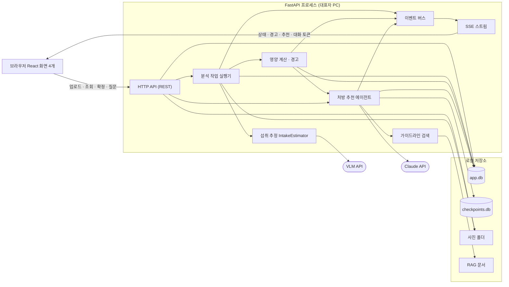
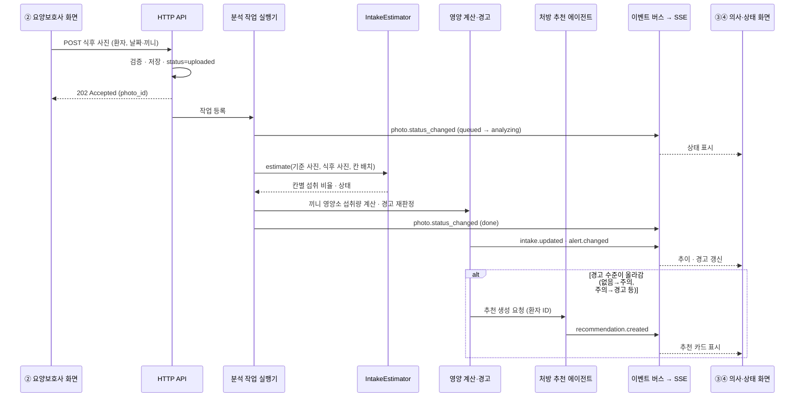
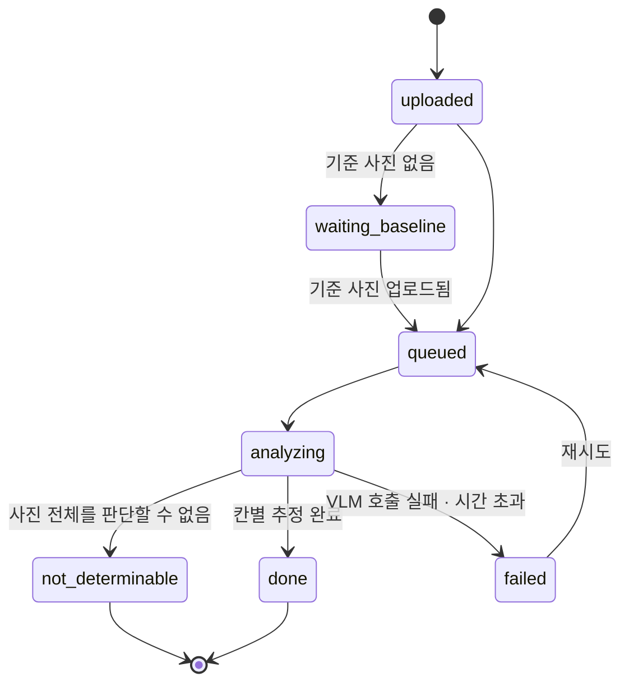

# 하루 파일럿 시스템 구조 (팀 제안안)

**상태**: 팀 제안안 — 팀 회의에서 확정 전 · **작성일**: 2026-11-27
**관련 문서**: [하루 파일럿 설계 전 검토](pilot-design-review.md) · [서비스 워크플로우](workflow.md) · [기획안](proposal.md)

[설계 전 검토](pilot-design-review.md)에서 정한 화면 4개, 기술 구성, 경고 규칙을 실제로 돌아가는 구조로 옮긴 안이다. 엔티티의 컬럼 단위 설계와 API의 요청·응답 스키마는 이 문서를 기준으로 다음 단계에서 정한다.

## 1. 전제

| 항목 | 전제 |
| --- | --- |
| 목적 | 시연용 파일럿. 흐름이 처음부터 끝까지 동작하는지 검증한다. |
| 접근 제어 | **없음.** 로그인·권한·사용자 계정을 두지 않는다. 화면에서 역할(영양사·요양보호사·의사)을 고르는 것은 화면 구분일 뿐 권한이 아니다. |
| 실행 환경 | 대표자 PC 한 대. 프로세스 하나(FastAPI)가 API, 화면 정적 파일, 분석 작업, 이벤트 전달을 모두 맡는다. |
| 데이터 | 모의 환자와 팀이 직접 찍은 모의 식판만 쓴다. 그래서 외부 API(VLM, Claude)로 사진과 기록을 보내도 된다. |
| VLM | 모델은 테스트로 정한다. 이 문서는 **입출력 인터페이스**만 정의하고, 모델별 구현은 그 인터페이스를 따르는 어댑터로 둔다. |

## 2. 구성 요소



| 구성 요소 | 하는 일 |
| --- | --- |
| 브라우저 화면 | ① 기준 식전 업로드(모바일), ② 식후 업로드(모바일), ③ 의사 대시보드 + 대화(PC), ④ 처리 상태 대시보드(PC). |
| HTTP API | 업로드, 조회, 처방 확정 같은 요청을 받는다. 화면 4개가 같은 API를 쓴다. |
| SSE | 서버가 화면으로 보내는 두 종류의 스트림. ① 시스템 이벤트(사진 처리 상태, 경고, 추천 카드), ② 대화 응답(토큰, 도구 호출). |
| 이벤트 버스 | 프로세스 안의 발행·구독 통로. 분석·경고·추천 모듈이 상태 변화를 발행하면, 연결된 SSE 구독자 모두에게 전달한다. |
| 분석 작업 실행기 | 업로드된 식후 사진을 `asyncio` 백그라운드 작업으로 분석한다. 동시 VLM 호출 수를 세마포어로 제한한다. |
| 섭취 추정 | `IntakeEstimator` 인터페이스. VLM 어댑터를 바꿔 끼워 모델을 비교한다. |
| 영양 계산·경고 | 칸별 섭취 비율 → 영양소 섭취량 → 일별 집계 → 주의/경고 판정. 외부 호출이 없는 순수 함수로 둔다. |
| 처방 추천 에이전트 | `create_agent` + Claude. 경고가 생기면 추천 카드를 만들고, 의사의 대화에 답한다. 대화 기록은 체크포인터(`checkpoints.db`)에 둔다. |
| VLM API | 섭취 추정에 쓰는 외부 모델. 테스트로 정한다. |
| 가이드라인 검색 | RAG 문서(`docs/research/rag-sources/`)에서 근거 구절을 찾는다. |

## 3. 핵심 흐름

### 3-1. 기준 식전 사진 (영양사)

1. 화면 ①이 날짜·끼니와 사진을 `POST /api/meals/{date}/{meal}/baseline`으로 보낸다.
2. 서버는 사진 내용을 검증(`PIL.Image.verify()`)하고, 서버가 만든 이름으로 사진 폴더에 저장한 뒤 끼니에 연결한다.
3. 그 끼니에 **기준 사진을 기다리던 식후 사진**(`waiting_baseline`)이 있으면 분석 대기열에 다시 넣는다.
4. `photo.status_changed` 이벤트를 발행한다.

같은 끼니에 기준 사진을 다시 올리면 새 사진으로 바꾸고, 그 끼니의 식후 분석을 모두 다시 실행한다 (결정). 이어서 일별 %와 경고를 다시 계산한다. 이미 확정된 처방은 확정 시점의 판단 기록이므로 바꾸지 않고, 추천은 자동 생성 규칙(경고 수준이 오를 때만)을 따른다. 기준 사진은 따로 검증하지 않고 저장만 한다 (결정).

### 3-2. 식후 사진 → 분석 → 경고 → 추천



- 업로드 응답은 분석을 기다리지 않는다(`202`). 결과는 SSE로 받는다.
- 기준 사진이 없는 끼니의 식후 사진은 `waiting_baseline`으로 두고 분석하지 않는다.
- 추천은 **경고 수준이 올라갈 때만** 자동으로 만든다 (결정). 같은 수준이 이어지면 기존 카드를 유지하고, 의사가 고친 카드를 자동으로 덮어쓰지 않는다. 의사는 카드의 "다시 만들기"로 최신 데이터 기준 카드를 다시 만들 수 있다(이전 카드는 `superseded`).

### 3-3. 처방 대화 (의사)

1. 의사가 환자를 고르면 화면 ③이 그 환자의 스레드 목록과 최근 스레드를 불러온다.
2. 질문은 `POST /api/threads/{thread_id}/messages`로 보내고, 응답 본문을 **SSE 스트림**으로 받는다. `EventSource`는 GET만 지원하므로 화면은 `fetch` 스트림으로 읽는다.
3. 에이전트가 "처방 초안 작성" 도구로 추천 카드를 고치면 `recommendation.updated` 이벤트가 시스템 스트림으로도 나가, 왼쪽 추천 카드가 함께 바뀐다.

### 3-4. 처방 확정 (의사)

0. (선택) 의사가 추천 카드에서 처방 유형을 골라 항목을 추가하거나 기존 항목을 고친다 (`PATCH /api/recommendations/{id}`, `recommendation.updated` 이벤트). 추천 카드가 없는 환자에게는 `POST /api/patients/{id}/prescriptions`로 처방을 직접 작성해 확정한다.
1. 의사가 추천 카드에서 항목을 고르고 `POST /api/recommendations/{id}/confirm`을 보낸다.
2. 서버는 처방(`status=confirmed`)을 만들고 원래 추천과 연결한다. 에이전트는 이 API를 호출할 수 없다. 확정은 화면의 의사 조작으로만 일어난다.
3. `prescription.confirmed` 이벤트를 발행하고, 섭취 추이 그래프에 처방 시점이 표시된다.

## 4. 사진 처리 상태



| 상태 | 뜻 | 화면 ④ 표시 |
| --- | --- | --- |
| `uploaded` | 저장됨, 작업 등록 전 | 업로드됨 |
| `waiting_baseline` | 그 끼니의 기준 사진이 없어 보류 | 기준 사진 대기 |
| `queued` | 분석 대기열에 있음 | 대기 중 |
| `analyzing` | VLM 호출 중 | 분석 중 |
| `done` | 칸별 추정 완료. 일부 칸이 판단 불가여도 `done`이다. | 완료 (판단 불가 칸 수 표시) |
| `not_determinable` | 사진 전체가 판단 불가 (식판이 아님, 심하게 흐림 등) | 판단 불가 · 재촬영 요청 |
| `failed` | 외부 호출 실패, 시간 초과 | 실패 · 재시도 버튼 |

- **칸 단위 판단 불가**와 **사진 단위 판단 불가**를 나눈다. 칸 하나가 가려졌다면 사진은 `done`이고, 그 칸만 `not_determinable`이다.
- 서버를 다시 켜면 `queued`·`analyzing`으로 남은 사진을 대기열에 다시 넣는다.

## 5. 섭취 추정 인터페이스 (VLM 무관)

분석 작업 실행기는 아래 인터페이스만 안다. 모델마다 어댑터를 하나씩 만들고, 설정값으로 어떤 어댑터를 쓸지 고른다. 저울 실측 평가 스크립트도 같은 인터페이스로 여러 어댑터를 돌려 비교한다.

```python
from __future__ import annotations

from dataclasses import dataclass
from enum import StrEnum
from pathlib import Path
from typing import Protocol


@dataclass(frozen=True)
class SlotSpec:
    slot_id: str          # 칸 위치 ID (예: "slot_3")
    menu_name: str        # 예: "두부조림"
    served_g: float       # 표준 배식량
    region_hint: str      # 식판 안 위치 설명 (예: "윗줄 왼쪽"). 좌표를 쓰는 모델은 무시해도 된다.


@dataclass(frozen=True)
class EstimationRequest:
    meal_id: str
    baseline_image: Path  # 끼니의 기준 식전 사진
    post_image: Path      # 환자의 식후 사진
    slots: tuple[SlotSpec, ...]


class SlotStatus(StrEnum):
    ESTIMATED = "estimated"
    NOT_DETERMINABLE = "not_determinable"


class QualityIssue(StrEnum):
    BLUR = "blur"
    OCCLUDED = "occluded"            # 손·수저 등이 칸을 가림
    ANGLE = "angle"                  # 기준 사진과 각도 차이가 큼
    LIGHTING = "lighting"
    TRAY_MISMATCH = "tray_mismatch"  # 기준 사진과 다른 식판·배치로 보임


@dataclass(frozen=True)
class SlotEstimate:
    slot_id: str
    intake_fraction_est: float | None  # 0~1, 0.1 단위. 판단 불가면 None
    status: SlotStatus
    quality_issues: tuple[QualityIssue, ...] = ()
    note: str = ""                     # 모델이 남긴 짧은 근거 (화면 표시용)


@dataclass(frozen=True)
class EstimationResult:
    meal_id: str
    slots: tuple[SlotEstimate, ...]
    image_status: SlotStatus           # 사진 전체 판단 가능 여부
    image_issues: tuple[QualityIssue, ...]
    estimate_basis: str                # "vlm:<어댑터 이름>"
    model_id: str                      # 실제 호출한 모델 ID
    latency_ms: int
    raw_response: str                  # 평가·디버깅용 원문


class EstimationError(Exception):
    """외부 호출 실패·시간 초과. 사진 처리 상태를 failed로 만든다."""


class IntakeEstimator(Protocol):
    name: str

    async def estimate(self, request: EstimationRequest) -> EstimationResult: ...
```

- **도메인 실패는 값으로, 외부 실패는 예외로** 나눈다. 판단 불가는 `status`로 돌려주고, 네트워크·시간 초과는 `EstimationError`로 던진다.
- **확신도는 두지 않는다.** 모델이 확신하지 못하는 칸은 `not_determinable`로 돌리고 이유를 `quality_issues`에 남기도록 프롬프트에서 기준을 정한다.
- 결과의 `slots`에는 요청한 칸이 **빠짐없이 한 번씩** 있어야 한다. 실행기는 칸 ID가 빠지거나 남는 응답, 범위를 벗어난 비율을 검증해 `failed`로 처리한다.
- 출력 필드는 기존 계약(`intake_fraction_est`, `estimate_basis`, `status`)을 따른다. `estimate_basis`는 어댑터 이름까지 담아 모델 비교 결과를 기록에 남긴다.
- 반복 호출로 결과를 안정화할지(열린 문제)는 어댑터 안에서 정한다. 인터페이스는 바뀌지 않는다.

## 6. 영양 계산·경고 모듈

외부 호출이 없는 순수 함수로 둔다. 테스트가 가장 쉬운 부분이므로 경계값을 테스트로 고정한다.

| 함수 | 입력 → 출력 |
| --- | --- |
| `meal_nutrients` | 칸별 추정 + 배식 계획(칸별 영양성분) → 끼니 에너지·단백질 섭취량 |
| `daily_requirement` | 환자(성별·나이·체중) → 하루 필요 에너지·단백질과 적용 기준 (ESPEN 또는 한국인 영양소 섭취기준) |
| `daily_intake` | 환자의 끼니 기록 → 일별 섭취량, 필요량 대비 %, 미기록 끼니 수 |
| `evaluate_alert` | 일별 섭취 이력 + 필요량 + 규칙 설정 → `none` / `caution` / `warning`, 근거 기간, 미기록 수 |

- 규칙의 임계값(75%, 50%)과 기간(7일, 연속 5일)은 설정값이다.
- 판단 불가 칸은 그 칸을 섭취량 합계에서 빼고, 끼니에 "추정 불완전" 표시를 남긴다. 미기록 끼니는 평균에서 뺀다 ([설계 전 검토](pilot-design-review.md) 5절).
- 경고 수준이 바뀌면 `alert.changed` 이벤트를 발행하고, 올라갔으면 추천 생성을 요청한다.

## 7. 처방 추천 에이전트

| 항목 | 제안 |
| --- | --- |
| 실행 | `langchain.agents.create_agent` + Claude. 추천 카드 생성과 대화가 같은 에이전트·같은 도구를 쓴다. |
| 추천 카드 | 같은 에이전트를 구조화 출력(카드 스키마)으로 한 번 실행해 저장한다. 구조화 출력 방식은 오전 검증 결과로 정한다 ([설계 전 검토](pilot-design-review.md) 4-2절의 기술 위험). |
| 대화 기록 | 체크포인터(`SqliteSaver` 계열)를 `checkpoints.db`에 둔다. `thread_id`는 스레드 ID이고, 스레드는 한 환자에게만 속한다. |
| 환자 범위 고정 | 도구는 요청마다 **선택한 환자 ID를 미리 묶어서** 만든다. 모델이 환자 ID를 인자로 고를 수 없으므로 다른 환자의 기록을 조회할 수 없다. 접근 제어가 아니라 맥락이 섞이지 않게 하는 장치다. |
| 확정 | 에이전트에는 처방 확정 도구를 주지 않는다. 초안 작성까지만 한다. |

**도구 (후보)**

| 도구 | 하는 일 |
| --- | --- |
| `get_intake_summary(days)` | 묶인 환자의 최근 섭취 추이, 경고 수준, 자주 남긴 메뉴 |
| `search_guidelines(query)` | 가이드라인 근거 구절 검색 → 문서 ID, 절, 본문, 출처 링크 |
| `draft_prescription(items)` | 묶인 환자의 추천 카드를 고친다. `recommendation.updated` 이벤트를 발행한다. |

**가이드라인 검색**: 문서가 4건(약 90쪽)뿐이라 처음에는 절 단위로 나눈 본문을 BM25로 검색한다. 한국어 문서 검색 품질이 부족하면 다국어 임베딩으로 바꾼다. 인터페이스(`search_guidelines`)는 그대로 둔다.

## 8. SSE 설계

### 8-1. 시스템 이벤트 스트림

`GET /api/events` — 화면 ③④가 `EventSource`로 구독한다. 화면 ①②는 자기가 올린 사진 상태만 보면 되므로 같은 스트림을 구독하고 자기 `photo_id`만 골라 쓴다.

```
event: photo.status_changed
id: 1042
data: {"photo_id": "p_81", "patient_id": "pt_B", "meal_id": "2026-11-27_lunch", "status": "analyzing", "at": "2026-11-27T12:31:05+09:00"}
```

| 이벤트 | 발행 시점 | 화면 |
| --- | --- | --- |
| `photo.status_changed` | 사진 처리 상태가 바뀔 때 | ①②④ |
| `intake.updated` | 끼니 섭취량이 새로 계산될 때 | ③④ |
| `alert.changed` | 환자의 경고 수준이 바뀔 때 | ③④ |
| `recommendation.created` · `recommendation.updated` | 추천 카드가 생기거나 고쳐질 때 | ③④ |
| `prescription.confirmed` | 처방이 확정될 때 | ③④ |

- 이벤트는 **"무엇이 바뀌었는지"만** 알린다. 화면은 이벤트를 받으면 해당 REST API로 최신 상태를 다시 읽는다. 그래서 이벤트를 놓쳐도 다음 조회에서 맞춰진다.
- 연결이 끊겼다가 다시 붙으면 화면은 보고 있던 데이터를 한 번 다시 읽는다. 놓친 이벤트를 다시 보내는 기능(`Last-Event-ID` 재전송)은 만들지 않는다.
- 연결 유지를 위해 15초마다 주석 줄(`: ping`)을 보낸다.

### 8-2. 대화 스트림

`POST /api/threads/{thread_id}/messages` — 응답이 `text/event-stream`이다. 에이전트의 스트림 출력을 아래 이벤트로 바꿔 보낸다.

| 이벤트 | 내용 |
| --- | --- |
| `token` | 답변 텍스트 조각 |
| `tool_start` | 도구 이름 (화면에 "섭취 요약 조회" 같은 표시) |
| `tool_end` | 도구 이름, 결과 요약 |
| `card_updated` | 이 대화로 추천 카드가 고쳐짐 (카드 ID) |
| `done` | 답변 끝 |
| `error` | 실패 사유 (화면 표시용 문장) |

## 9. HTTP API (초안)

| 메서드 · 경로 | 화면 | 하는 일 |
| --- | --- | --- |
| `GET /api/meals/{date}/{meal}` | ①② | 그 끼니의 배식 계획(칸 배치), 기준 사진 여부 |
| `POST /api/meals/{date}/{meal}/baseline` | ① | 기준 식전 사진 업로드 |
| `GET /api/patients` | ②③ | 환자 목록과 경고 수준 |
| `GET /api/patients/{id}` | ③ | 환자 요약 카드: 기본 정보, 최근 체중과 변화, 현재 목표와 출처, 최근 평가 |
| `POST /api/photos` | ② | 식후 사진 업로드 (환자, 날짜·끼니) → `202`. 그 끼니의 발주가 없거나 `ordered`가 아니면(금식·취소) `409` |
| `GET /api/photos?date=&meal=` | ④ | 사진별 처리 상태 |
| `POST /api/photos/{id}/retry` | ④ | `failed` 사진 재분석 |
| `GET /api/patients/{id}/intake?days=14` | ③ | 일별 섭취 추이, 필요량, 미기록 수, 처방 시점 |
| `GET /api/patients/{id}/alert` | ③ | 현재 경고 수준과 근거 |
| `GET /api/patients/{id}/recommendation` | ③ | 현재 추천 카드 |
| `PATCH /api/recommendations/{id}` | ③ | 의사가 추천 항목을 추가·수정 (`added_by`·`last_modified_by = "doctor"`) |
| `POST /api/recommendations/{id}/confirm` | ③ | 고른 항목으로 처방 확정 |
| `POST /api/patients/{id}/recommendation/regenerate` | ③ | 추천 "다시 만들기": 최신 데이터로 새 카드를 만들고 이전 카드는 `superseded` |
| `POST /api/patients/{id}/prescriptions` | ③ | 추천 없이 의사가 처방을 직접 작성해 확정 |
| `GET /api/patients/{id}/prescriptions` | ③ | 처방 이력 |
| `GET /api/patients/{id}/threads` · `POST` | ③ | 환자의 스레드 목록 · 새 대화 |
| `GET /api/threads/{id}/messages` | ③ | 스레드의 지난 메시지 |
| `POST /api/threads/{id}/messages` | ③ | 질문 → 대화 스트림 (SSE) |
| `GET /api/events` | ①~④ | 시스템 이벤트 스트림 (SSE) |
| `POST /api/admin/reset` | 시연 | 모의 이력만 남기고 시연 중 업로드를 지운다 |

## 10. 저장소

| 위치 | 내용 |
| --- | --- |
| `var/app.db` | 업무 데이터: 환자, 예정 식단(칸·배식량·영양성분), 실제 발주된 식사(칸별 섭취), 사진, 일별 섭취, 경고, 추천, 처방, 스레드 목록. 행마다 데이터 출처(모의/업로드)를 둔다. |
| `var/checkpoints.db` | 에이전트 체크포인터 (대화 상태). 업무 DB와 나눠 리셋을 쉽게 한다. |
| `var/photos/` | 사진 파일. 이름은 서버가 만든다 (`<photo_id>.jpg`). |
| `data/seed/` | 모의 환자, 배식 계획, 발주(특이사항 포함), 1~2주 모의 섭취 이력. 배식 계획과 발주는 화면에서 입력하지 않고 여기서만 넣는다. |
| `docs/research/rag-sources/` | RAG 문서 원본 |

테이블과 필드는 [데이터 모델](data-model.md)에 정리했다. 데이터는 환자, 예정 식단, 실제 발주된 식사의 세 묶음으로 나눈다.

## 11. 코드 구성 (제안)

```
backend/
  app/
    main.py            FastAPI 앱, 정적 파일, 시작 시 미완료 작업 복구
    config.py          설정 (어댑터 선택, 임계값, 동시 호출 수, 경로)
    api/               라우터: meals, photos, patients, recommendations, threads, events
    events/            이벤트 버스, SSE 직렬화
    jobs/              분석 작업 실행기 (대기열, 세마포어, 상태 전이)
    intake/            IntakeEstimator 인터페이스, VLM 어댑터들, 응답 검증
    nutrition/         필요량, 섭취량 환산, 일별 집계, 경고 규칙
    recommender/       에이전트, 도구, 카드 스키마, 가이드라인 검색
    storage/           SQLite 접근, 사진 저장
  tests/
  scripts/
    seed.py            모의 데이터 넣기
    eval_intake.py     저울 실측 식판으로 어댑터 비교
frontend/              React (Vite). 빌드 결과를 FastAPI가 제공
data/seed/
var/                   실행 중 생기는 파일 (git 제외)
```

모듈 담당([설계 전 검토](pilot-design-review.md) 7절)과 이렇게 맞춘다: 섭취 추정 → `intake/`·`eval_intake.py`, 영양 계산·경고 → `nutrition/`·`seed.py`, 백엔드·화면 → `api/`·`events/`·`jobs/`·`storage/`·`frontend/`, 처방 추천 → `recommender/`.

## 12. 실패 처리

| 상황 | 처리 |
| --- | --- |
| VLM 호출 실패·시간 초과 | 사진 `failed`, 화면 ④에 재시도 버튼. 자동 재시도는 1회. |
| VLM 응답이 형식에 맞지 않음 | `failed`로 처리하고 원문을 남긴다. |
| 기준 사진 없음 | `waiting_baseline`. 기준 사진이 올라오면 자동으로 분석한다. |
| 추천 생성 실패 | 경고는 그대로 표시하고 카드 자리에 "추천 생성 실패 · 다시 만들기"를 둔다. |
| 대화 중 실패 | 대화 스트림에 `error` 이벤트를 보내고, 스레드는 이어서 쓸 수 있게 둔다. |
| 서버 재시작 | 미완료 분석을 대기열에 다시 넣는다. 대화는 체크포인터에서 이어진다. |

## 13. 열린 문제

1. **VLM 선정** — 저울 실측 식판으로 어댑터를 비교해 정한다. 반복 호출로 결과를 안정화할지도 함께 정한다.
2. **추천 카드 구조화 출력** — `create_agent` + Claude에서 어떤 방식이 동작하는지 오전에 확인한다.
3. **가이드라인 검색 품질** — BM25로 한국어·영어 혼합 문서에서 근거를 잘 찾는지 확인하고, 부족하면 임베딩으로 바꾼다.
